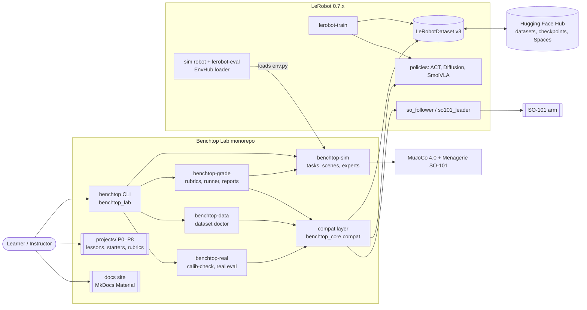
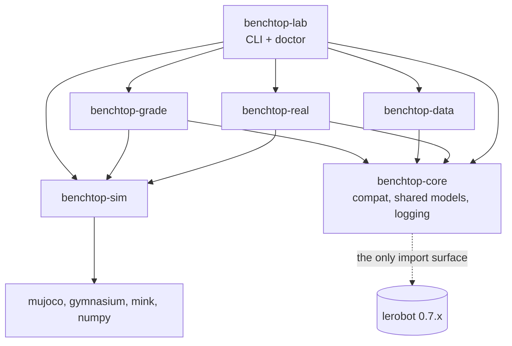
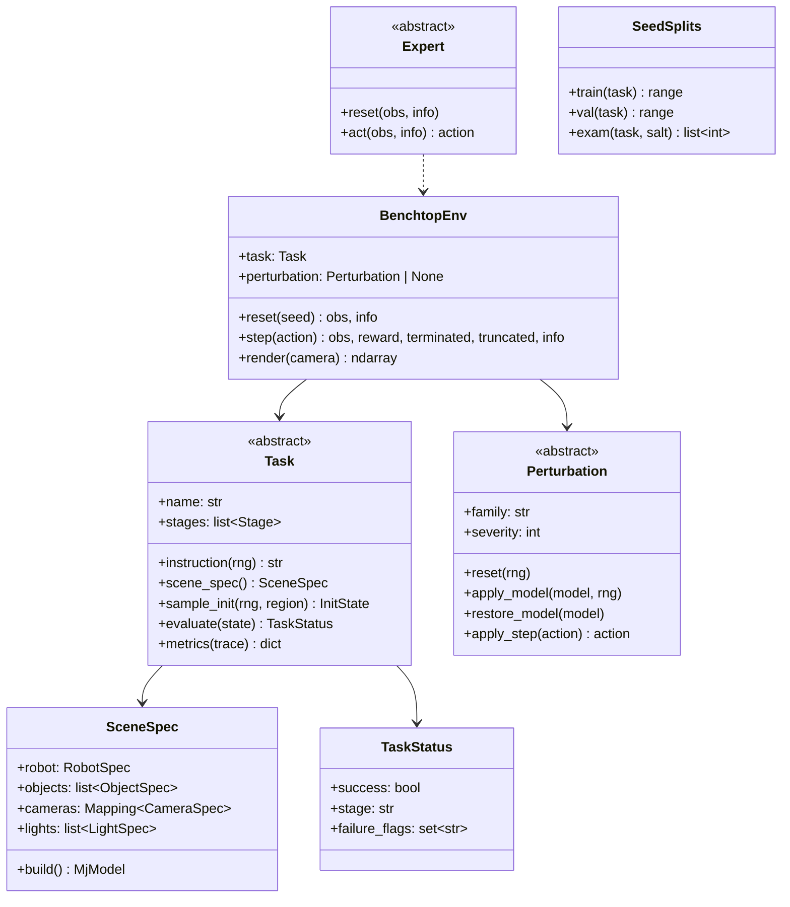
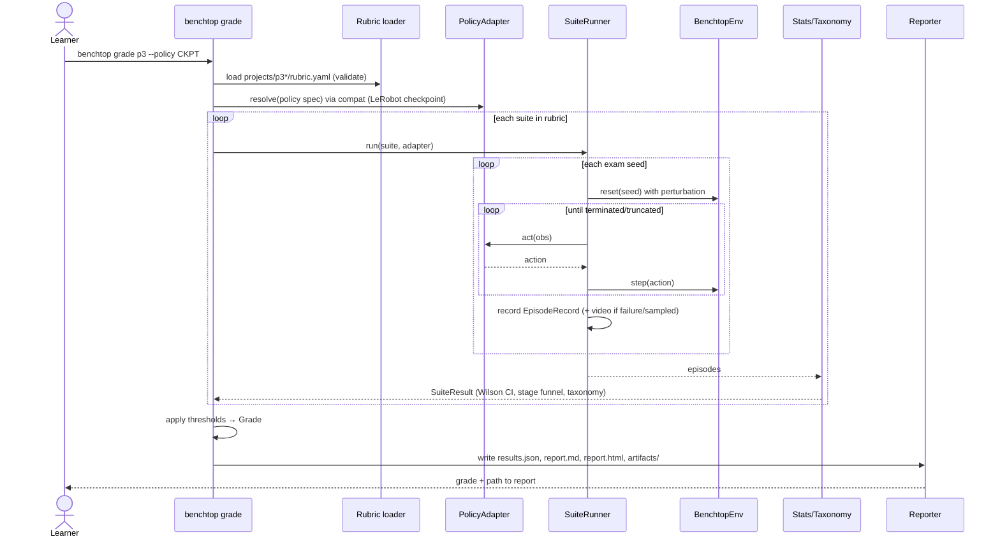
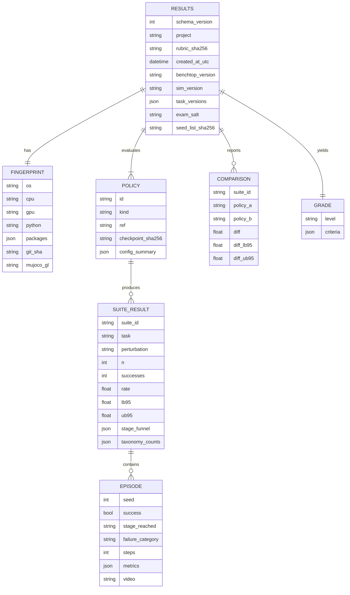

# Benchtop Lab: Architecture

This document describes how the pieces fit, the interfaces between them, and the data model. The product scope lives in
[PLAN.md](PLAN.md); the build order lives in [MILESTONES.md](MILESTONES.md). Architecture changes are recorded as ADRs in
[DECISIONS.md](DECISIONS.md).

## 1. System context



Key idea: **LeRobot can drive our environments directly** (they satisfy its env contract and are exported as EnvHub
folders), and **our tools call LeRobot only through one compat layer**. Learners use LeRobot's own commands for
recording and training, so what they learn transfers.

## 2. Package responsibilities and dependency rules



| Package | Owns | Must not |
| --- | --- | --- |
| `benchtop_core` | `compat` (the only module that imports `lerobot`, besides the `policies` plugin subpackage, ADR-007), shared Pydantic base models, `schema_version` helpers, logging, paths, environment fingerprint | contain task or grading logic |
| `benchtop_sim` | MJCF assets, scene builder, `BenchtopEnv`, tasks, success checks, randomization, perturbations, experts, IK, EnvHub export | import `lerobot`, `torch` or any other `benchtop_*` package |
| `benchtop_grade` | Rubric models, suite runner, policy adapters, statistics, taxonomy, results schema, report rendering | import hardware drivers |
| `benchtop_data` | Dataset doctor checks and reports | write to datasets (read-only) |
| `benchtop_real` | Calibration check, real evaluation protocol, grid mat generator | command motion without `--allow-motion` |
| `benchtop_lab` | The `benchtop` CLI (Typer), `benchtop doctor`, meta-package pulling everything in | contain domain logic |

Enforced with import-linter contracts in CI. `benchtop_sim` stays torch-free and dependency-light so EnvHub servers and
instructors' machines stay small.

## 3. `benchtop-sim` internals



- **Scene builder.** MJCF is assembled with `mujoco.MjSpec` from the vendored Menagerie SO-101 plus task objects,
  cameras (`front`, `wrist`) and lights. No string templating of XML.
- **Physics.** `implicitfast` integrator (Menagerie default); timestep chosen so that `substeps = round(1/(fps·dt))`.
- **Control.** Actions are degrees (gripper 0–100) converted to actuator radians/ctrl by one tested function shared
  with the experts, matching the official Space's mapping.
- **Rendering.** Lazy `mujoco.Renderer` created on first `reset()` (EGL-safe in worker processes). Image size is a
  constructor option; CPU projects default to 128×128.
- **Determinism.** All randomness flows from `np.random.Generator(PCG64(seed))`, split per concern (objects, camera,
  joints, perturbation) with `SeedSequence.spawn`, so adding a perturbation does not change object placement.
- **EnvHub export.** `benchtop envs export <task> --out envhub/<task>` writes a **self-contained** folder by default:
  `env.py` (a `make_env` that imports a vendored copy of the `benchtop_sim` runtime placed next to it), the assets,
  `requirements.txt` (only `mujoco`, `gymnasium`, `numpy` and `mink`, pinned), and a generated `README.md` task card
  with licenses. This works locally (`--env.hub_path=./envhub/<task>`) and as a Space without `benchtop-sim` being on
  PyPI. Once `benchtop-sim` is published (decision D4), a `--slim` export pins it instead.
- **Perturbation application.** In-place `MjModel` edits are restored from a pristine copy at each `reset()`;
  geometry/texture variants are pre-compiled and cached; step-level perturbations implement `reset()` (see PLAN §6.4).

## 4. `benchtop-grade` flow



- **Policy adapters** implement `PolicyAdapter.reset()` and `act(obs: dict) -> np.ndarray`. Implementations:
  `LeRobotCheckpointAdapter` (loads `pretrained_model/` with its pre/post-processors through `compat`, handles
  `PolicyOutput` vs tensor returns, action chunk queues, `--rename_map` equivalent), `CallableAdapter`
  (`module:object`), `ExpertAdapter`, `ReplayAdapter`.
- **Execution.** Episodes run in a process pool (`--workers`, default = physical cores − 1) for CPU policies, created
  with the `spawn` start method (never `fork`, which is unsafe with GL/EGL contexts and torch threads); each worker
  builds its own env and renderer. GPU policies run in-process with batched envs (gymnasium `SyncVectorEnv`).
  Results are identical regardless of worker count because every episode is fully determined by its seed.
- **Cross-check.** A test runs the same checkpoint through `lerobot-eval` on our EnvHub export and asserts the success
  count matches the grader on the same seeds.

## 5. Data model

### 5.1 `rubric.yaml` (validated by `benchtop_grade.models.Rubric`)

```yaml
schema_version: 1
project: p3_first_policy
title: "Your first policy"
task: pick_place
policy_inputs: [state, environment_state]      # what the policy may observe
image_size: [128, 128]
suites:
  - id: nominal
    split: exam
    episodes: 100
  - id: mass
    split: exam
    episodes: 50
    perturbation: {family: object_mass, severity: 2}
grades:
  pass:
    - {suite: nominal, metric: success_lb95, op: ">=", value: 0.60}
  merit:
    - {artifact: scaling_plot}
    - {artifact: comparison}
  distinction:
    - {suite: nominal, metric: success_lb95, op: ">=", value: 0.80}
    - {reflection: scaling_explanation, min_words: 150}
artifacts:
  - {id: scaling_plot, kind: image, path: outputs/scaling.png}
  - {id: comparison, kind: comparison, policies: [mlp_bc, act_state], suites: [nominal]}
reflections:
  - {id: scaling_explanation, prompt: "Explain why success changed with the number of demos."}
```

### 5.2 `results.json` (validated by `benchtop_grade.models.Results`; JSON Schema published in docs)



### 5.3 Dataset doctor report

`DoctorReport{schema_version, dataset{repo_id|path, codebase_version, fps, n_episodes, features}, score,
findings[{check_id, severity, title, detail, episodes[], fix, docs_url}], plots[]}`.

### 5.4 Real evaluation log

`RealEvalLog{schema_version, robot{type, id, calibration_sha256}, protocol{mat, zones, trials}, trials[{index, zone,
outcome, failure_category, note, video}], summary{n, successes, lb95, ub95, zone_map}}`.

Each task carries an integer `task_version` bumped whenever its physics, randomization or success logic changes;
results recorded against an older `task_version` are flagged as stale by `--verify` and the report.

All models are Pydantic v2, export JSON Schema to `docs/reference/schemas/`, and carry `schema_version` with explicit
migration functions.

## 6. Compat layer (`benchtop_core.compat`)

The single place that knows LeRobot's API (with one sibling exception: `benchtop_core.policies`, which contains the
small `benchtop_mlp` LeRobot policy plugin used in P3 and therefore imports `lerobot` and `torch`; see ADR-007). Surface:

| Function | Purpose |
| --- | --- |
| `load_policy(path, device) -> LoadedPolicy` | Load a pretrained policy and its processors; normalize return types |
| `open_dataset(repo_or_path) -> DatasetView` | Read-only access to frames, episodes, metadata, stats, videos |
| `make_hub_env(path, **kwargs)` | Load an EnvHub folder through LeRobot (contract tests) |
| `lerobot_version()` | Report and verify the pinned range |
| `connect_so101(...)` | Hardware access for `benchtop_real` (follower/leader read-only by default) |

Contract tests in `packages/benchtop-core/tests/compat/` pin observable behaviour. A scheduled CI job runs them against
LeRobot `main` and opens an issue when they break (the "upstream canary").

## 7. Process and runtime model

- Everything runs locally; no services. Hub access is optional (download datasets/checkpoints, push results if the
  learner wants).
- Long runs (`grade`, `demo`) show Rich progress, are interruptible, and resume from a partial results file.
- Logs: structured (JSON lines) under `outputs/benchtop/logs/`; human output to the console.
- Configuration precedence: CLI flags > `benchtop.toml` in the project > defaults.

## 8. Error handling and UX rules

- Every user-facing error has: what happened, the likely cause, and the next command to run (often `benchtop doctor`).
- The grader never silently changes a rubric; mismatches between policy inputs and rubric `policy_inputs` are errors.
- Hardware commands default to read-only and print a safety checklist before any motion.

## 9. Versioning and releases

- Semantic versioning for all packages, released together (one version for the monorepo).
- `schema_version` for rubrics, results and reports, independent of package versions.
- Supported matrix per release: LeRobot minor, MuJoCo minor, Python 3.12 and 3.13, Linux and macOS.

## 10. Security and privacy

- No telemetry. No network calls except explicit Hub downloads/uploads.
- Secrets (HF tokens) are read only from the environment or the HF CLI cache; never logged, never written to results.
- `gitleaks` in pre-commit and CI. EnvHub exports contain no credentials.
