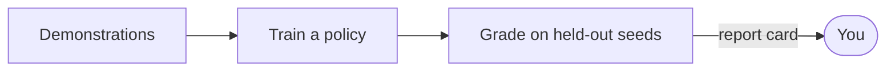

<!-- SPDX-License-Identifier: CC-BY-4.0 -->

# Writing docs

The site is built with Material for MkDocs from the Markdown files in `docs/`. This page shows the building
blocks you can use and the checks a page must pass.
{ .lead }

## Preview and check

```bash
uv run mkdocs serve            # live preview at http://127.0.0.1:8000
uv run mkdocs build --strict   # the check CI runs: any warning or broken link fails
uv run python tools/check_site.py site   # no external requests, required landmarks present
```

The first build downloads the diagram and maths libraries once and caches them in `.cache/`; after that the
build works offline.

## House style

- Write plainly and define every term the first time it appears.
- Use real typographic characters: curly quotes are not required in Markdown source, but use an en dash for
  ranges (10–20), `×` for dimensions and a non-breaking space between a number and its unit
  (`30&nbsp;fps`).
- Every number must come from a real run recorded in the repository, or be marked provisional.
- Never describe a planned feature as available.
- Link to files outside `docs/` with an absolute GitHub URL. Links between pages are relative paths to the
  `.md` file, so the strict build can verify them.
- Start each page with a front-matter `title` and `description`, then the SPDX line
  `<!-- SPDX-License-Identifier: CC-BY-4.0 -->`.

## Building blocks

### Callouts

A callout carries its meaning in an icon and a title, never in colour alone.

```markdown
!!! warning "Check the units"

    Arm joints are in degrees, not radians.
```

!!! note "Note"

    Context the reader can skip without getting lost.

!!! tip "Tip"

    A shortcut or a better way.

!!! warning "Check the units"

    Arm joints are in degrees, not radians.

!!! danger "This can move a real arm"

    Anything that risks hardware or data.

Lessons use three fixed callouts for the predict, run, explain rhythm: `!!! question "Predict"` before an
experiment, a code block for the run, and `??? example "Explain"` (collapsed) for the answer.

??? example "Explain"

    A collapsed block keeps the answer out of sight until the reader has made a prediction.

### Tabs

=== "Linux"

    ```bash
    export MUJOCO_GL=egl
    ```

=== "macOS"

    ```bash
    # No variable needed: MuJoCo uses the native OpenGL backend.
    ```

### Code

Fenced blocks get a copy button. Add a title for a file name and `hl_lines` to point at the lines that matter.

```python title="seeded.py" hl_lines="4"
import numpy as np


rng = np.random.default_rng(seed=7)  # every random draw comes from an explicit seed
print(rng.uniform(-1.0, 1.0, size=3))
```

### Tables

Right-align numeric columns (`---:`) and show uncertainty next to the estimate with the `interval` class.

| Policy | Episodes | Success | 95% interval |
| --- | ---: | ---: | ---: |
| Example A (illustrative) | 100 | 0.70 | [0.60, 0.78]{ .interval } |
| Example B (illustrative) | 100 | 0.82 | [0.73, 0.88]{ .interval } |

### Diagrams

Diagrams are written as [Mermaid](https://mermaid.js.org/) text, so they follow the light and dark themes and
can be reviewed in a pull request.



### Maths

Inline maths goes between dollar signs, $\hat{p} = k / n$, and display maths between double dollar signs:

$$
\text{half-width} \approx \frac{z}{\sqrt{n}} \sqrt{\hat{p}\,(1 - \hat{p})}
$$

### Figures

Wrap an image in `<figure>` with a `<figcaption>`; figures are numbered automatically. Every image needs alt
text that states the finding, not the pixels. Keep committed images under 300&nbsp;kB.

```html
<figure markdown>
  
  <figcaption>Success on held-out seeds against the number of demonstrations.</figcaption>
</figure>
```

## Design system

Colours, type and spacing come from one token file, `docs/assets/stylesheets/tokens.css`. Do not add colours
or font sizes to a page. The fonts (Inter, Source Serif 4, JetBrains Mono) are served from this site; nothing is
loaded from a third party, and the site sets no cookies and runs no analytics.
