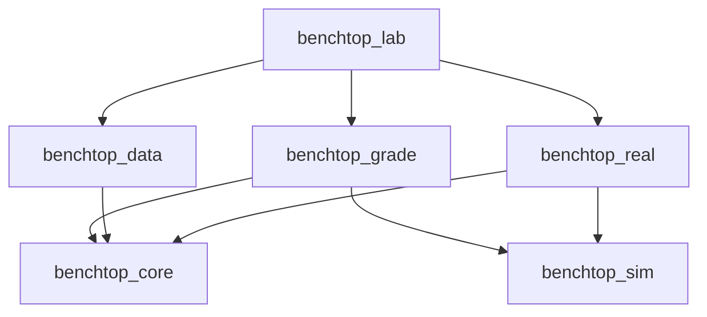

<!-- SPDX-License-Identifier: CC-BY-4.0 -->

# Python API

Benchtop Lab is six Python packages that install together. These pages are generated from the docstrings in the
source, so they always describe the code on `main`.
{ .lead }

| Package | Purpose |
| --- | --- |
| [`benchtop_core`](benchtop_core.md) | Shared models and the compatibility layer, the only code that imports LeRobot |
| [`benchtop_sim`](benchtop_sim.md) | MuJoCo tasks, scenes and scripted experts for the SO-101 |
| [`benchtop_grade`](benchtop_grade.md) | Rubrics, evaluation runner and report cards |
| [`benchtop_data`](benchtop_data.md) | The dataset doctor |
| [`benchtop_real`](benchtop_real.md) | Calibration check and real-robot evaluation |
| [`benchtop_lab`](benchtop_lab.md) | The `benchtop` command line and the meta-package |

Dependencies point one way: the command line depends on the tools, and the tools depend on the core and the
simulator. The simulator imports no other Benchtop package, so it can be used on its own.

